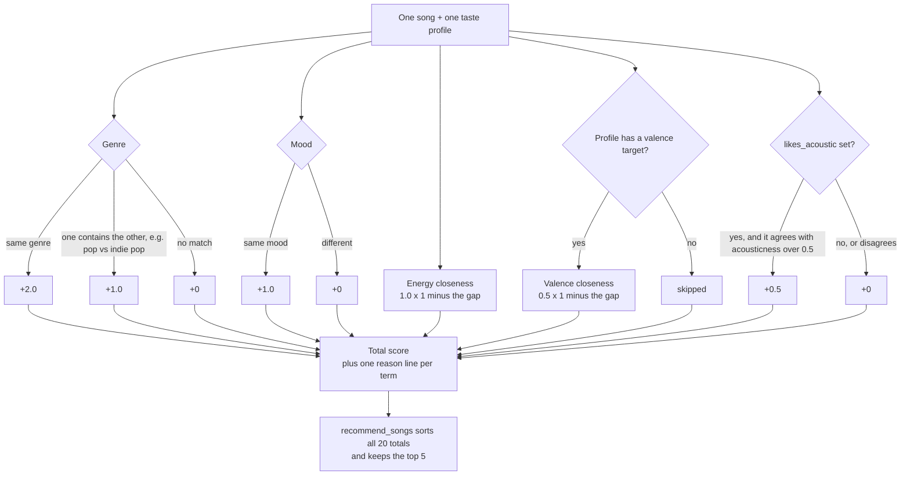
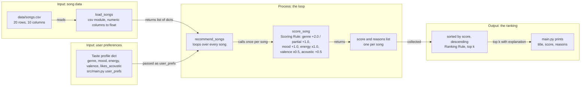

# 🎵 Music Recommender Simulation

## Project Summary

In this project you will build and explain a small music recommender system.

Your goal is to:

- Represent songs and a user "taste profile" as data
- Design a scoring rule that turns that data into recommendations
- Evaluate what your system gets right and wrong
- Reflect on how this mirrors real world AI recommenders

This version is a content-based music recommender that runs from the command line over a small CSV catalog. It scores each song against a listener's taste profile on genre, mood, energy, valence, and acousticness, then ranks the songs and explains each pick with a list of reasons.

---

## How The System Works

I believe Spotify does a combination of both content-based and collaborative filtering. When you create a new account, Spotify and apps that serve content of some form, be it news, podcasts, Substack, Netflix, YouTube, etc., ask a new user for their preferences; Spotify asks for a handful of artists you like, five or more. That is the beginning of a taste profile based on what I explicitly tell the app. My first picture of what happens next was old-school: content-based filtering first, then collaborative filtering later as the profile fills out. When I checked that against Spotify's own research (Nov 3, 2026), it turned out both kinds of signal run from day one, and what changes over time is the input: the sign-up picks at first, then my listening. The profile itself is not a list of picks or genre buckets; it is one learned vector built from the audio of what I play and from which songs show up together on people's playlists, over roughly the last six months, month and week. Genre is not an input to that at all; it emerges from the clusters afterward, which I found interesting because it means my genre weight below is a shortcut for signals a real system learns.

If all we have is song data, then we have no choice but to do content-based filtering. The input data is the seven attribute columns of `data/songs.csv`: genre, mood, energy, tempo_bpm, valence, danceability, and acousticness. The user preferences are a taste profile dictionary that stands in for the onboarding step, where a new listener picks artists they like. Collaborative filtering, which needs other users' behavior, is out of reach because we have no likes, skips, playlists, or listening history. The ranking has two parts. The Scoring Rule grades one song by itself: how well does it fit this listener? It's like a judge filling in a rubric for a single contestant. The Ranking Rule then looks at all the grades, lines the songs up from highest to lowest, and keeps the top few. A score alone can't tell you what to play, and a list can't be put in order without scores. So we need both.

### Features each Song uses

- genre
- mood
- energy
- valence
- acousticness

(`tempo_bpm` and `danceability` are loaded but not scored in v1.)

### What a taste profile stores

- favorite genre
- favorite mood
- target energy
- target valence
- likes_acoustic

### Algorithm recipe (decided Nov 2, 2026)

- Genre match: +2.0. A partial match, where one genre string contains the other (case-insensitive, e.g. "indie pop" vs "pop"), earns +1.0.
- Mood match: +1.0.
- Energy closeness: 1.0 × (1 − |song energy − target energy|).
- Valence closeness: 0.5 × (1 − |song valence − target valence|), applied only when the profile has a valence target.
- Acoustic bonus: +0.5 when the profile's `likes_acoustic` agrees with the song's acousticness > 0.5.
- `tempo_bpm` and `danceability` are not scored in v1.
- Every score comes with a list of reasons.

Closeness is `1 − |song − target|`, so the closer a song is to the target, the higher it scores, whether the song is above or below. Worked example with a target energy of 0.8: a song at 0.82 scores 0.98, a song at 0.42 scores 0.62, and a song at 0.28 scores 0.48.

Point recipe as a flowchart (added Nov 3, 2026):



### Why genre weighs the most, and the bias I expect

Most people describe the kind of music they like first and foremost by genre. People don't say "I like high-energy or low-valence music"; they say "I like hip hop, pop, country or classical." So genre is the label a listener gives, and the numeric features are how the system tells songs apart inside that label. Because genre is worth +2.0, this system might over-prioritize genre and ignore great songs that match the user's mood and energy. That is a bias I chose on purpose, and the weight-shift experiment later is where I test it.

### Dataset and profiles (decided Nov 2, 2026)

The catalog is 20 songs across pop, lofi, rock, ambient, jazz, synthwave, indie pop, hip-hop, edm, country, classical, metal, r&b, latin, folk, and reggae, with Neon Echo and LoRoom each repeated on purpose so a later diversity penalty has something to act on.

| Profile | genre | mood | energy | valence | likes_acoustic |
|---|---|---|---|---|---|
| pop_happy | pop | happy | 0.8 | 0.8 | — (no bonus) |
| chill_lofi | lofi | chill | 0.35 | 0.6 | True |
| intense_rock | rock | intense | 0.9 | 0.45 | — (no bonus) |
| hiphop_fan | hip-hop | confident | 0.75 | 0.65 | — (no bonus) |
| conflicted | pop | sad | 0.9 | 0.3 | — (no bonus) |
| folk_acoustic | folk | hopeful | 0.45 | 0.7 | True |

### Data flow sketch (Phase 2 Step 4, Nov 2, 2026)

One song's path from the CSV to the ranked list. Source file: [`diagrams/data_flow.mmd`](diagrams/data_flow.mmd); it renders on GitHub and at mermaid.live.



---

## Getting Started

### Setup

This project uses [uv](https://docs.astral.sh/uv/) with Python 3.13 (pinned in `.python-version`). Run these from the repo root:

```bash
uv venv
uv pip install -r requirements.txt
.venv/bin/python --version        # should print Python 3.13.x
```

Without uv, this also works: `python -m venv .venv && .venv/bin/pip install -r requirements.txt`.

### Run the recommender

```bash
.venv/bin/python -m src.main --all
```

With no flags it runs the default profile (`pop_happy`) and prints the top five songs with the reasons for each score. The flags:

- `--profile NAME` runs one profile: `pop_happy`, `chill_lofi`, `intense_rock`, `hiphop_fan`, `conflicted` or `folk_acoustic`.
- `--all` runs all six profiles.
- `--k N` changes how many songs are recommended (default 5).
- `--experiment NAME` swaps in an alternate weight set: `weight_shift`, `no_mood` or `genre_half`.
- `--mode NAME` picks a ranking mode: `weighted` (the default recipe), `genre_first`, `mood_first` or `energy_similarity`.
- `--diversity [PENALTY]` subtracts a penalty (default 0.5) for each repeat of an artist already in the list.
- `--table` prints a table (rank, title, artist, score, why) instead of the because lines.

For example: `.venv/bin/python -m src.main --profile hiphop_fan --mode genre_first --diversity --table`

### Running Tests

```bash
.venv/bin/python -m pytest -v
```

Run it from the repo root. The suite is 43 tests, all passing:

- `tests/test_recommender.py` (2): the starter tests for the `Recommender` class.
- `tests/test_data.py` (5): `load_songs` returns enough songs with the required columns and diverse genres, converts the numeric columns to floats, and raises a clear error for a missing file.
- `tests/test_scoring.py` (16): each scoring term, the reasons, partial genre matches, and how ties are ranked.
- `tests/test_cli.py` (6): the profiles are distinct and all run, the output shows title, score and reasons, the flag defaults parse, and the experiments pass their weights through.
- `tests/test_modes.py` (6): every mode returns a scorer, an unknown mode raises, `weighted` is `score_song` itself, `genre_first` outranks it on genre, and explicit weights override a mode's.
- `tests/test_diversity.py` (5): a repeat artist is penalized with a reason, a zero penalty changes nothing, the input list is not mutated, and `recommend_songs` accepts the penalty.
- `tests/test_table.py` (3): the table has a header and rows, includes the reasons, and returns a string instead of printing.

---

## Sample Recommendation Output

Output of `python -m src.main` (default profile `pop_happy`, top 5):

```
Loaded songs: 20

== pop_happy: genre=pop, mood=happy, energy=0.8 ==
1. Sunrise City — Neon Echo  [4.46]
   because: genre match (+2.0); mood match (+1.0); energy close to target (+0.98); valence close to target (+0.48)
2. Rooftop Lights — Indigo Parade  [3.46]
   because: genre partial match (+1.0); mood match (+1.0); energy close to target (+0.96); valence close to target (+0.49)
3. Gym Hero — Max Pulse  [3.35]
   because: genre match (+2.0); energy close to target (+0.87); valence close to target (+0.48)
4. Rain on the Radio — June Alder  [2.98]
   because: genre match (+2.0); energy close to target (+0.75); valence far from target (+0.22)
5. Fuego en la Calle — Luna Caliente  [1.47]
   because: energy close to target (+1.00); valence close to target (+0.47)
```

## Visual Summary Table

The same run can print as a table instead of the because lines: `python -m src.main --profile pop_happy --table`. It uses the `tabulate` library through `format_table` in `src/formatting.py`, in GitHub format, with the reasons wrapped at about sixty characters so the "Why" column stays readable. The table combines with `--mode` and `--diversity`, so `python -m src.main --all --table --mode genre_first --diversity` prints six tables with the penalty visible in the Why column. I added it because the reasons line is the whole point of this recommender, and a column makes it easier to compare two songs' reasons at a glance than the indented lines do.

```
== pop_happy: genre=pop, mood=happy, energy=0.8 ==
| #   | Title             | Artist        | Score   | Why                                                         |
|-----|-------------------|---------------|---------|-------------------------------------------------------------|
| 1   | Sunrise City      | Neon Echo     | 4.46    | genre match (+2.0); mood match (+1.0); energy close to      |
|     |                   |               |         | target (+0.98); valence close to target (+0.48)             |
| 2   | Rooftop Lights    | Indigo Parade | 3.46    | genre partial match (+1.0); mood match (+1.0); energy close |
|     |                   |               |         | to target (+0.96); valence close to target (+0.49)          |
| 3   | Gym Hero          | Max Pulse     | 3.35    | genre match (+2.0); energy close to target (+0.87); valence |
|     |                   |               |         | close to target (+0.48)                                     |
| 4   | Rain on the Radio | June Alder    | 2.98    | genre match (+2.0); energy close to target (+0.75); valence |
|     |                   |               |         | far from target (+0.22)                                     |
| 5   | Fuego en la Calle | Luna Caliente | 1.47    | energy close to target (+1.00); valence close to target     |
|     |                   |               |         | (+0.47)                                                     |
```

---

## Experiments You Tried

Weight-shift experiment: energy weight 2.0 and genre weight 1.0 (default 1.0 and 2.0), run with `python -m src.main --profile pop_happy --experiment weight_shift`:

```
Loaded songs: 20

== pop_happy: genre=pop, mood=happy, energy=0.8 ==
1. Sunrise City — Neon Echo  [4.44]
   because: genre match (+1.0); mood match (+1.0); energy close to target (+1.96); valence close to target (+0.48)
2. Rooftop Lights — Indigo Parade  [3.92]
   because: genre partial match (+0.5); mood match (+1.0); energy close to target (+1.92); valence close to target (+0.49)
3. Gym Hero — Max Pulse  [3.23]
   because: genre match (+1.0); energy close to target (+1.74); valence close to target (+0.48)
4. Rain on the Radio — June Alder  [2.73]
   because: genre match (+1.0); energy close to target (+1.50); valence far from target (+0.22)
5. Fuego en la Calle — Luna Caliente  [2.47]
   because: energy close to target (+2.00); valence close to target (+0.47)
```

Under `weight_shift` the `pop_happy` top five keeps the same songs in the same order, but the scores move: Rain on the Radio (genre match) falls from 2.98 to 2.73 while Fuego en la Calle (no genre match) rises from 1.47 to 2.47, so the gap between them shrinks from 1.51 to 0.26. Past the top five, Skyline Static and Night Drive Loop swap ranks 7 and 8 (1.32 and 1.29 before, 2.18 and 2.25 after).

Weight-shift experiment on the `conflicted` profile, run with `python -m src.main --profile conflicted --experiment weight_shift`:

```
Loaded songs: 20

== conflicted: genre=pop, mood=sad, energy=0.9 ==
1. Rain on the Radio — June Alder  [3.77]
   because: genre match (+1.0); mood match (+1.0); energy close to target (+1.30); valence close to target (+0.47)
2. Gym Hero — Max Pulse  [3.21]
   because: genre match (+1.0); energy close to target (+1.94); valence close to target (+0.27)
3. Sunrise City — Neon Echo  [3.07]
   because: genre match (+1.0); energy close to target (+1.84); valence far from target (+0.23)
4. Rooftop Lights — Indigo Parade  [2.46]
   because: genre partial match (+0.5); energy close to target (+1.72); valence far from target (+0.24)
5. Storm Runner — Voltline  [2.39]
   because: energy close to target (+1.98); valence close to target (+0.41)
```

Under `weight_shift` the first four `conflicted` songs keep their order, and Rain on the Radio's lead over Gym Hero shrinks from 0.89 to 0.56 (4.12 vs 3.23 before, 3.77 vs 3.21 after). Empty Hall Etude (the mood match with far energy) rises from 1.74 to 2.02 but drops from rank 5 to rank 10, and Storm Runner moves from rank 7 (1.40) to rank 5 (2.39).

Genre-half experiment: genre weight 0.5, everything else at the default, run with `python -m src.main --profile pop_happy --experiment genre_half`:

```
Loaded songs: 20

== pop_happy: genre=pop, mood=happy, energy=0.8 ==
1. Sunrise City — Neon Echo  [2.96]
   because: genre match (+0.5); mood match (+1.0); energy close to target (+0.98); valence close to target (+0.48)
2. Rooftop Lights — Indigo Parade  [2.71]
   because: genre partial match (+0.25); mood match (+1.0); energy close to target (+0.96); valence close to target (+0.49)
3. Gym Hero — Max Pulse  [1.85]
   because: genre match (+0.5); energy close to target (+0.87); valence close to target (+0.48)
4. Rain on the Radio — June Alder  [1.48]
   because: genre match (+0.5); energy close to target (+0.75); valence far from target (+0.22)
5. Fuego en la Calle — Luna Caliente  [1.47]
   because: energy close to target (+1.00); valence close to target (+0.47)
```

Under `genre_half` the `pop_happy` top five keeps the same songs in the same order, and each full genre match loses 1.5 points (Rain on the Radio 2.98 to 1.48, Gym Hero 3.35 to 1.85, Sunrise City 4.46 to 2.96) and the partial match Rooftop Lights loses 0.75 (3.46 to 2.71), while Fuego en la Calle (no genre match) stays at 1.47. Rain on the Radio's lead over Fuego en la Calle shrinks from 1.51 to 0.01, and ranks 6 through 10 keep their default order and scores.

My reading of the three experiments: none of them made the recommendations more accurate for every profile at once; they made them different, and each one showed which single term had been deciding a slot. For pop_happy nothing moved because its top songs match on every term at once, so the weights were partly redundant. For conflicted, weight_shift finally let the loud songs in, which is closer to what a listener asking for energy 0.9 probably meant. And genre_half is the proof of the bias I predicted above: a full genre match had been worth more than every numeric term combined, since Rain on the Radio's 1.51 lead over a song that fits the numbers better was almost entirely the word "pop".

---

## Limitations and Risks

- **The catalog is too small for the recipe.** Twenty invented songs across sixteen genres means three of my six profiles have exactly one song of their genre, so the genre weight decides the first slot and then goes quiet, and the rest of the list is off-genre songs ranked on numbers alone. A real service has millions of songs and can let genre act as a gate.
- **It never learns.** Spotify models a listener as one learned vector that updates from plays and playlists over long and short time windows; my profile is a dict with five settings and no time axis, and it never changes, because the catalog has no plays, skips, likes or playlists. Collaborative filtering can never switch on here.
- **The features are opinions, not measurements.** Pandora's analysts label about 400 traits per song and Spotify learns hundreds of dimensions from the audio; I score five columns whose numbers and labels were typed by whoever wrote the row. It does not know lyrics or language at all, and "valence 0.25" means "I imagined this song as sad," not something anyone heard.

The model card goes deeper on the genre bias, with the numbers.

---

## Reflection

The full write-up, including limitations and bias with the numbers, is in the [Model Card](model_card.md).

What I learned about turning data into predictions is that it takes two separate rules, and that the whole program is eight words long once you see them: load, pick, loop, score, sort, cut, join, print. The scoring rule gives one song a single number from several features, like a judge filling in a rubric for one contestant, and the ranking rule lines up twenty of those numbers and keeps the top five. A score alone cannot tell you what to play, and a list cannot be ordered without scores. A real system has the same shape (features, profile, score, sort) but learns the profile and the weights from behavior; mine has hand-set weights and learns nothing, which is the cold-start state every new user starts in.

Where bias shows up is in the weights and in who typed the data. My genre weight is a bias I chose on purpose, because people name their taste by genre first, and the genre_half experiment measured exactly what it costs: a slow sad pop song beat a loud happy song that fit the numbers better, by 1.51 points, almost all of it the word "pop". That is the small version of what Spotify's own 2020 study found, that algorithm-driven listening is less diverse than listening people choose themselves. The other place is the labels: whoever decides that a song is "chill" or "pop" has already shaped every recommendation, and in my catalog that was one person typing rows. The diversity penalty is my one counter-measure, and it taught me that fairness costs a little accuracy, which is a trade a real system has to make on purpose rather than by accident.


