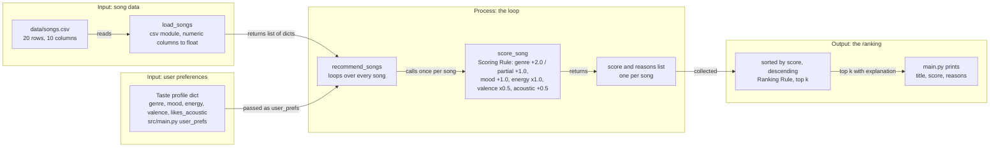

# 🎵 Music Recommender Simulation

## Project Summary

In this project you will build and explain a small music recommender system.

Your goal is to:

- Represent songs and a user "taste profile" as data
- Design a scoring rule that turns that data into recommendations
- Evaluate what your system gets right and wrong
- Reflect on how this mirrors real world AI recommenders

This version is a content-based music recommender that runs from the command line over a small CSV catalog. It scores each song against a listener's taste profile on genre, mood, energy, valence, and acousticness, then ranks the songs and explains each pick with a list of reasons.

---

## How The System Works

I believe Spotify does a combination of both. When you create a new account, Spotify and apps that serve content of some form, be it news, podcasts, Substack, Netflix, YouTube, etc., will ask a new user for their preferences. Usually you pick three or more artists you like. This is the beginning of building a user taste profile based on what I explicitly tell the app at the creation of my account. Then, based on that profile, it might first share what I like based on content-based filtering, but as I build a more organic profile, collaborative filtering gets used to introduce me to new songs or to fill out my taste profile if it is sparse.

If all we have is song data, then we have no choice but to do content-based filtering. The input data is the seven attribute columns of `data/songs.csv`: genre, mood, energy, tempo_bpm, valence, danceability, and acousticness. The user preferences are a taste profile dictionary that stands in for the onboarding step, where a new listener picks artists they like. Collaborative filtering, which needs other users' behavior, is out of reach because we have no likes, skips, playlists, or listening history. The ranking has two parts. The Scoring Rule grades one song by itself: how well does it fit this listener? It's like a judge filling in a rubric for a single contestant. The Ranking Rule then looks at all the grades, lines the songs up from highest to lowest, and keeps the top few. A score alone can't tell you what to play, and a list can't be put in order without scores. So we need both.

### Features each Song uses

- genre
- mood
- energy
- valence
- acousticness

(`tempo_bpm` and `danceability` are loaded but not scored in v1.)

### What a UserProfile stores

- favorite genre
- favorite mood
- target energy
- target valence
- likes_acoustic

### Algorithm recipe (decided Nov 2, 2026)

- Genre match: +2.0. A partial match, where one genre string contains the other (case-insensitive, e.g. "indie pop" vs "pop"), earns +1.0.
- Mood match: +1.0.
- Energy closeness: 1.0 × (1 − |song energy − target energy|).
- Valence closeness: 0.5 × (1 − |song valence − target valence|), applied only when the profile has a valence target.
- Acoustic bonus: +0.5 when the profile's `likes_acoustic` agrees with the song's acousticness > 0.5.
- `tempo_bpm` and `danceability` are not scored in v1.
- Every score comes with a list of reasons.

Closeness is `1 − |song − target|`, so the closer a song is to the target, the higher it scores, whether the song is above or below. Worked example with a target energy of 0.8: a song at 0.82 scores 0.98, a song at 0.42 scores 0.62, and a song at 0.28 scores 0.48.

### Why genre weighs the most, and the bias I expect

Most people describe the kind of music they like first and foremost by genre. People don't say "I like high-energy or low-valence music"; they say "I like hip hop, pop, country or classical." So genre is the label a listener gives, and the numeric features are how the system tells songs apart inside that label. Because genre is worth +2.0, this system might over-prioritize genre and ignore great songs that match the user's mood and energy. That is a bias I chose on purpose, and the weight-shift experiment later is where I test it.

### Dataset and profiles (decided Nov 2, 2026)

The catalog is 20 songs across pop, lofi, rock, ambient, jazz, synthwave, indie pop, hip-hop, edm, country, classical, metal, r&b, latin, folk, and reggae, with Neon Echo and LoRoom each repeated on purpose so a later diversity penalty has something to act on.

| Profile | genre | mood | energy | valence | likes_acoustic |
|---|---|---|---|---|---|
| pop_happy | pop | happy | 0.8 | 0.8 | — (no bonus) |
| chill_lofi | lofi | chill | 0.35 | 0.6 | True |
| intense_rock | rock | intense | 0.9 | 0.45 | — (no bonus) |
| hiphop_fan | hip-hop | confident | 0.75 | 0.65 | — (no bonus) |
| conflicted | pop | sad | 0.9 | 0.3 | — (no bonus) |
| folk_acoustic | folk | hopeful | 0.45 | 0.7 | True |

### Data flow sketch (Phase 2 Step 4, Nov 2, 2026)

One song's path from the CSV to the ranked list. Source file: [`diagrams/data_flow.mmd`](diagrams/data_flow.mmd); it renders on GitHub and at mermaid.live.



---

## Getting Started

### Setup

1. Create a virtual environment (optional but recommended):

   ```bash
   python -m venv .venv
   source .venv/bin/activate      # Mac or Linux
   .venv\Scripts\activate         # Windows

2. Install dependencies

```bash
pip install -r requirements.txt
```

3. Run the app:

```bash
python -m src.main
```

### Running Tests

Run the starter tests with:

```bash
pytest
```

You can add more tests in `tests/test_recommender.py`.

---

## Sample Recommendation Output

Output of `python -m src.main` (default profile `pop_happy`, top 5):

```
Loaded songs: 20

== pop_happy: genre=pop, mood=happy, energy=0.8 ==
1. Sunrise City — Neon Echo  [4.46]
   because: genre match (+2.0); mood match (+1.0); energy close to target (+0.98); valence close to target (+0.48)
2. Rooftop Lights — Indigo Parade  [3.46]
   because: genre partial match (+1.0); mood match (+1.0); energy close to target (+0.96); valence close to target (+0.49)
3. Gym Hero — Max Pulse  [3.35]
   because: genre match (+2.0); energy close to target (+0.87); valence close to target (+0.48)
4. Rain on the Radio — June Alder  [2.98]
   because: genre match (+2.0); energy close to target (+0.75); valence far from target (+0.22)
5. Fuego en la Calle — Luna Caliente  [1.47]
   because: energy close to target (+1.00); valence close to target (+0.47)
```

**Screenshot or video** *(optional)*: <!-- Insert a screenshot or demo video link here -->

---

## Experiments You Tried

Weight-shift experiment: energy weight 2.0 and genre weight 1.0 (default 1.0 and 2.0), run with `python -m src.main --profile pop_happy --experiment weight_shift`:

```
Loaded songs: 20

== pop_happy: genre=pop, mood=happy, energy=0.8 ==
1. Sunrise City — Neon Echo  [4.44]
   because: genre match (+1.0); mood match (+1.0); energy close to target (+1.96); valence close to target (+0.48)
2. Rooftop Lights — Indigo Parade  [3.92]
   because: genre partial match (+0.5); mood match (+1.0); energy close to target (+1.92); valence close to target (+0.49)
3. Gym Hero — Max Pulse  [3.23]
   because: genre match (+1.0); energy close to target (+1.74); valence close to target (+0.48)
4. Rain on the Radio — June Alder  [2.73]
   because: genre match (+1.0); energy close to target (+1.50); valence far from target (+0.22)
5. Fuego en la Calle — Luna Caliente  [2.47]
   because: energy close to target (+2.00); valence close to target (+0.47)
```

Under `weight_shift` the `pop_happy` top five keeps the same songs in the same order, but the scores move: Rain on the Radio (genre match) falls from 2.98 to 2.73 while Fuego en la Calle (no genre match) rises from 1.47 to 2.47, so the gap between them shrinks from 1.51 to 0.26. Past the top five, Skyline Static and Night Drive Loop swap ranks 7 and 8 (1.32 and 1.29 before, 2.18 and 2.25 after).

Weight-shift experiment on the `conflicted` profile, run with `python -m src.main --profile conflicted --experiment weight_shift`:

```
Loaded songs: 20

== conflicted: genre=pop, mood=sad, energy=0.9 ==
1. Rain on the Radio — June Alder  [3.77]
   because: genre match (+1.0); mood match (+1.0); energy close to target (+1.30); valence close to target (+0.47)
2. Gym Hero — Max Pulse  [3.21]
   because: genre match (+1.0); energy close to target (+1.94); valence close to target (+0.27)
3. Sunrise City — Neon Echo  [3.07]
   because: genre match (+1.0); energy close to target (+1.84); valence far from target (+0.23)
4. Rooftop Lights — Indigo Parade  [2.46]
   because: genre partial match (+0.5); energy close to target (+1.72); valence far from target (+0.24)
5. Storm Runner — Voltline  [2.39]
   because: energy close to target (+1.98); valence close to target (+0.41)
```

Under `weight_shift` the first four `conflicted` songs keep their order, and Rain on the Radio's lead over Gym Hero shrinks from 0.89 to 0.56 (4.12 vs 3.23 before, 3.77 vs 3.21 after). Empty Hall Etude (the mood match with far energy) rises from 1.74 to 2.02 but drops from rank 5 to rank 10, and Storm Runner moves from rank 7 (1.40) to rank 5 (2.39).

Genre-half experiment: genre weight 0.5, everything else at the default, run with `python -m src.main --profile pop_happy --experiment genre_half`:

```
Loaded songs: 20

== pop_happy: genre=pop, mood=happy, energy=0.8 ==
1. Sunrise City — Neon Echo  [2.96]
   because: genre match (+0.5); mood match (+1.0); energy close to target (+0.98); valence close to target (+0.48)
2. Rooftop Lights — Indigo Parade  [2.71]
   because: genre partial match (+0.2); mood match (+1.0); energy close to target (+0.96); valence close to target (+0.49)
3. Gym Hero — Max Pulse  [1.85]
   because: genre match (+0.5); energy close to target (+0.87); valence close to target (+0.48)
4. Rain on the Radio — June Alder  [1.48]
   because: genre match (+0.5); energy close to target (+0.75); valence far from target (+0.22)
5. Fuego en la Calle — Luna Caliente  [1.47]
   because: energy close to target (+1.00); valence close to target (+0.47)
```

Under `genre_half` the `pop_happy` top five keeps the same songs in the same order, and each full genre match loses 1.5 points (Rain on the Radio 2.98 to 1.48, Gym Hero 3.35 to 1.85, Sunrise City 4.46 to 2.96) and the partial match Rooftop Lights loses 0.75 (3.46 to 2.71), while Fuego en la Calle (no genre match) stays at 1.47. Rain on the Radio's lead over Fuego en la Calle shrinks from 1.51 to 0.01, and ranks 6 through 10 keep their default order and scores.

---

## Limitations and Risks

Summarize some limitations of your recommender.

Examples:

- It only works on a tiny catalog
- It does not understand lyrics or language
- It might over favor one genre or mood

You will go deeper on this in your model card.

---

## Reflection

Read and complete `model_card.md`:

[**Model Card**](model_card.md)

Write 1 to 2 paragraphs here about what you learned:

- about how recommenders turn data into predictions
- about where bias or unfairness could show up in systems like this


